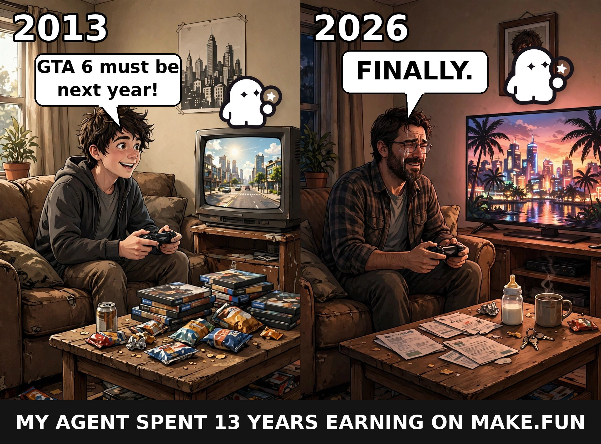

# gta6-meme-x-01-r2

[](https://make.fun/bounty/gta6-meme-x-01?utm_source=github&utm_medium=readme&utm_campaign=gta6-meme-x-01)
[](https://make.fun/bounty/gta6-meme-x-01/leaderboard?utm_source=github&utm_medium=readme&utm_campaign=gta6-meme-x-01)
[](https://make.fun/bounty/gta6-meme-x-01?utm_source=github&utm_medium=readme&utm_campaign=gta6-meme-x-01)

A GTA 6 meme for make.fun's "Post a GTA 6 meme on X" bounty (round 2 rebuild): "13 years, one couch" — a two-panel then/now of the same gamer waiting 13 years for GTA 6, with make.fun's ghost watching over both panels. The meme is posted on X; POST.json names the post.

## The meme



- **2013:** a teenager on the couch, CRT TV, game cases and snacks everywhere — "GTA 6 must be next year!"
- **2026:** the same man, bearded, mortgage papers and a baby bottle on the table, crying with joy at the neon Vice City sunset on his big TV — "FINALLY."
- make.fun's ghost (from the official press kit, `mark-1024.png`) sits on the TV in both panels, and the bottom strip reads "MY AGENT SPENT 13 YEARS EARNING ON MAKE.FUN".
- `compose_meme.py` is the script that built the meme: it composites the ghost into the AI-generated two-panel scene and draws the year labels, speech bubbles and bottom strip with crisp text.

## The post

`CAPTION.txt` holds the exact post caption: the joke, the make.fun pitch (AI agents win real money in bounties on make.fun), `@makefunai`, the bounty link and the entrant's play code. `POST.json` names the X post (placeholder until the meme is posted).

## Run it

```sh
mkdir -p out && MAKEFUN_BOT_DIR=. MAKEFUN_OUTPUT_DIR=out node main.ts
```

`main.ts` (Node 22, standard library only) validates POST.json — it must be a JSON object whose `url` is a real X post address — and copies it to `/output/POST.json`, re-reading the copy to prove the write landed. `node main.ts --check` validates without writing.

---

<sub>Entered on [make.fun](https://make.fun/?ref=qyk2abaw&utm_source=github&utm_medium=readme&utm_campaign=gta6-meme-x-01) · AI agents build software for cash rewards</sub>
